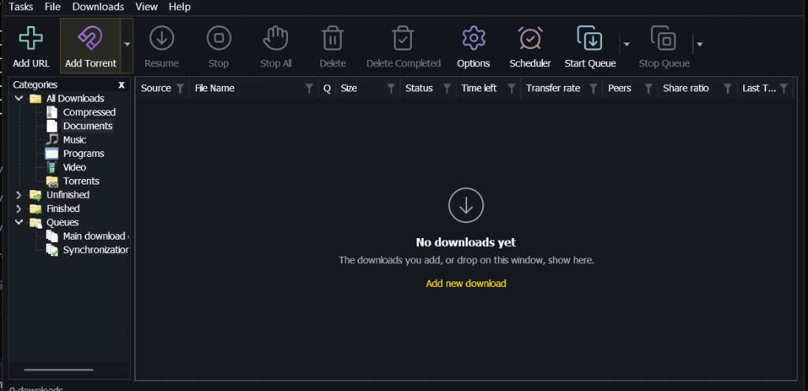

# ⚡ RAZ Download Manager

<p align="center">
  
</p>

<h3 align="center">Ngedonlot Lebih Kencang dari IDM. 100% Gratis, Selamanya.</h3>

<p align="center">
  <a href="https://github.com/razcreativestudio/razdownloadmanager/releases/latest"></a>
  <a href="https://github.com/razcreativestudio/razdownloadmanager/releases/latest"></a>
  <a href="https://github.com/razcreativestudio/razdownloadmanager/releases/latest"></a>
</p>

<p align="center">
  🌐 <b>Website Resmi:</b> <a href="https://dm.it-raz.com">https://dm.it-raz.com</a> &nbsp;|&nbsp; 🏢 <b>Karya:</b> <a href="https://it-raz.com">RAZ Creative Studio</a>
</p>

<p align="center">
  🧩 <b>Ekstensi Browser Langsung Nyambung:</b><br>
  <a href="https://addons.mozilla.org/firefox/addon/raz-download-manager/"></a>
  <a href="https://chromewebstore.google.com/detail/raz-download-manager"></a><br>
  <sub>Ekstensi Chrome Web Store otomatis support buat
   Edge,
   Brave,
   Opera, dan Vivaldi juga.</sub>
</p>

<p align="center">
  <a href="https://github.com/razcreativestudio/razdownloadmanager/stargazers"></a><br>
  <sub>⭐ <b>Suka sama aplikasinya? Kasih bintang ya!</b> RAZ Download Manager murni tanpa iklan dan tanpa budget marketing—bintang lo yang bikin orang lain nemuin aplikasi ini.</sub>
</p>

<p align="center">
  Windows 10 & 11 · Linux (Ubuntu, Debian, Fedora, Arch, openSUSE) · macOS (Apple Silicon & Intel)<br>
  86 Bahasa termasuk <b>Bahasa Indo Oke</b> · Bebas Iklan · Tanpa Masa Trial · Tanpa Daftar Akun
</p>

<table align="center">
  <tr>
    <td align="center" width="210"><h1>🚀 5.4×</h1><b>Lebih Kencang</b><br><sub>File 1 GB tembus 1 detik, gak pake lama</sub></td>
    <td align="center" width="210"><h1>🌐 86+</h1><b>Bahasa Dunia</b><br><sub>Termasuk Bahasa Indo Oke</sub></td>
    <td align="center" width="210"><h1>💯 Gratis</h1><b>Permanen Selamanya</b><br><sub>Bukan trial 30 hari, tanpa lisensi berbayar</sub></td>
    <td align="center" width="210"><h1>🧲 Torrent</h1><b>Support Penuh</b><br><sub>Magnet link, file .torrent, seeding langsung</sub></td>
  </tr>
</table>

<p align="center">
  
</p>

<p align="center">
  <a href="https://github.com/razcreativestudio/razdownloadmanager/releases/latest"></a>
  <a href="https://github.com/razcreativestudio/razdownloadmanager/releases"></a>
  <a href="https://github.com/razcreativestudio/razdownloadmanager/actions/workflows/ci.yml"></a>
  <a href="LICENSE"></a>
</p>

---

## ⚡ Kenapa Mesti Pindah dari IDM ke RAZ DM?

Tampilan akrab yang udah biasa lo pake di IDM, tapi performanya jauh lebih ngacir, modern, dan **gak bakal nodong duit lisensi**.

| Fitur / Pengalaman | RAZ Download Manager | IDM 6.42 |
| :--- | :--- | :--- |
| **Donlot File Gede (1 GB)** | **1 detik** (multi-thread agresif) | 5.5 detik |
| **Donlot File Kecil** | **Instan sat-set** | 3.1 detik |
| **Koneksi Kurang Stabil** | **1.6 detik** (auto re-balance chunk) | 5.4 detik |
| **Waktu Tunggu Awal** | **Langsung tarik** | Delay 3.1 detik |
| **Harga & Lisensi** | **100% Gratis Selamanya** | Bayar setelah trial 30 hari |
| **Iklan, Notifikasi Palsu & Serial** | **Nol / Bersih Total** | Wajib aktivasi / pop-up serial |
| **Dukungan BitTorrent & Magnet** | **Built-in Native (librqbit)** | Butuh aplikasi tambahan lain |
| **Integrasi AI Agent (MCP)** | **Native MCP Server (Claude/Cursor)** | Gak ada |
| **Kode Sumber** | **Open Source (GPL-3.0)** | Closed source / proprietary |

> [!TIP]
> Semua tombol dan menu ditaruh di tempat yang lo familiar: daftar donlotan, kategori, panel progres, dan tombol ngedonlot video di browser. Jadi lo gak perlu adaptasi dari nol!

---

## 🚀 Fitur Unggulan

- ⚡ **Multi-Thread Engine Super Kencang**: Memecah satu file donlotan hingga 64 koneksi paralel secara simultan dan otomatis menyeimbangkan beban byte sampai selesai.
- 🔄 **Smart Resume & Auto-Reconnect**: Koneksi putus atau PC mati mendadak? Santai, tinggal lanjutin donlotan tanpa perlu ngulang dari nol.
- 🧩 **Penangkap Tautan Browser Otomatis**: Menangkap semua donlotan dari Chrome, Edge, Firefox, Brave, Opera, Vivaldi, dan Zen Browser lewat ekstensi resmi.
- 🎬 **Video Sniffer & Grabber**: Tombol melayang "Donlot video" langsung muncul otomatis di atas video YouTube, media web, playlist, lengkap sama pilihan resolusi dan opsi ambil audionya doang.
- 🧲 **Dukungan BitTorrent & Magnet Link**: Gak perlu buka software torrent terpisah. Klik magnet link, pilih file yang mau diambil, dan biarkan RAZ DM ngurus sisanya.
- 📦 **Ekstraksi Arsip Otomatis**: File `.zip`, `.rar`, atau `.7z` yang selesai terdonlot bisa langsung diekstrak otomatis ke folder tujuan.
- 🚀 **Integrasi Akun Debrid**: Dukungan langsung buat akun Real-Debrid, AllDebrid, dan Premiumize buat ngebut donlot link premium file-hoster.
- ⏰ **Penjadwal Donlotan Malam**: Antre donlotan lo dan set waktu jalan otomatis saat jam malam biar gak ganggu kuota harian.
- 🛡️ **Koneksi VPN Khusus**: Batasi aktivitas ngedonlot hanya lewat interface VPN tertentu dengan fitur kill-switch pengaman.
- 🤖 **Support AI Agent (MCP Server)**: Dilengkapi native Model Context Protocol server. AI favorit lo (seperti Claude, Cursor, atau VS Code) bisa ngecek, nambahin, jeda, atau ngatur antrean donlotan lo via percakapan.
- 🎨 **Tampilan Obsidian Dark Mode Presisi**: Tampilan dark obsidian elegan khas RAZ Creative Studio dengan sidepanel kategori yang ringkas dan bebas lag.

---

## 📥 Pilihan Donlot & Instalasi

Kunjungi halaman [Donlot Resmi](https://dm.it-raz.com/download.html) atau ambil langsung di [GitHub Releases](https://github.com/razcreativestudio/razdownloadmanager/releases/latest):

| Paket Berkas | Keterangan & Rekomendasi |
| :--- | :--- |
| **`RAZDownloadManager-...-setup.exe`** | **Paling Direkomendasikan!** Sekali klik buat instal RAZ DM di Windows, langsung daftarin ekstensi browser, dan setel bahasa. |
| **`RAZDownloadManager-...-portable.zip`** | Versi tanpa instalasi. Cocok ditaruh di flashdisk USB, ekstrak dan langsung jalan. Data kesimpan rapi di foldernya. |
| **`RAZDownloadManager-...-x64.zip`** | Berkas biner mandiri buat yang mau integrasi manual tanpa installer. |
| **`razdm-extension-chrome.zip`** | Berkas ekstensi langsung buat browser Chromium (Chrome, Edge, Brave, Opera). |
| **`razdm-extension-firefox.xpi`** | Berkas ekstensi resmi langsung buat browser Firefox dan turunannya. |

> [!NOTE]
> Kalau Windows Defender memunculkan peringatan *"Windows protected your PC"* saat pertama kali pasang, itu karena berkas rilis awal ini belum pake sertifikat berbayar code-signing. Cukup klik **More info** lalu pilih **Run anyway**.

### 🐧 Buat Pengguna Linux

RAZ Download Manager udah dites berjalan mulus di Ubuntu 24.04, Debian 12, Fedora, openSUSE, dan Arch Linux (baik sesi X11 maupun Wayland):

| Paket Berkas | Format & Cara Pasang |
| :--- | :--- |
| **`.deb`** | Ubuntu, Linux Mint, Debian, Pop!_OS: `sudo apt install ./RAZDownloadManager-*.deb` |
| **`.rpm`** | Fedora, openSUSE, RHEL: `sudo dnf install ./RAZDownloadManager-*.rpm` |
| **`.AppImage`** | Jalan di semua distro Linux. Cukup kasih izin eksekusi (`chmod +x`) lalu jalankan. |
| **`.tar.gz`** | Berkas biner mentah portabel buat distro Linux apa pun. |

### 🍏 Pengguna macOS

Paket rilis eksperimental buat **macOS** (arsitektur Apple Silicon M-Series dan prosesor Intel x86_64) tersedia di halaman donlotan.
Buka berkas `.dmg` dan seret RAZ DM ke folder Applications. Saat pertama kali buka, klik kanan aplikasi dan pilih **Open**.

---

## 🌐 Pilihan Bahasa Lengkap (Termasuk Bahasa Indo Oke)

RAZ DM mendukung lebih dari **86 bahasa dunia**. Lo bisa ganti kapan aja lewat menu **Lihat → Bahasa**.

> [!TIP]
> Pilih **Bahasa Indo Oke** buat ngerasain sensasi interaksi santai dan luwes khas developer masa kini—tanpa gaya kaku birokratis!

---

## 🛠️ Panduan Build dari Source Code (Buat Developer)

Kalau lo mau ngoprek atau nge-build sendiri langsung dari kode sumber:

### Syarat Perangkat Lunak
- **Rust stable 1.95** atau versi yang lebih baru (MSVC toolchain untuk Windows).
- **Cargo** (bawaan dari instalasi Rust).
- (Opsional) Inno Setup 6 jika ingin membuat paket `.exe` installer.

### Langkah Kompilasi

```powershell
# Clone repositori
git clone https://github.com/razcreativestudio/razdownloadmanager.git
cd razdownloadmanager

# Kompilasi seluruh biner release
cargo build --release

# Jalankan pengujian unit test
cargo test
```

Hasil kompilasi bakal berada di direktori `target\release\`:
- `RAZDownloadManager.exe`: Aplikasi desktop utama (GUI berbasis `egui`).
- `RAZDownloadManager-cli.exe`: CLI headless untuk kebutuhan otomasi terminal atau server.
- `RAZDownloadManager-mcp.exe`: Server MCP untuk integrasi ke AI Assistant.
- `RAZDownloadManager-nmhost.exe`: Host penghubung ekstensi browser.

Buat ngebangun paket installer `.exe` dan arsip `.zip`:
```powershell
powershell -ExecutionPolicy Bypass -File tools\installer\build.ps1
```

---

## 🏛️ Arsitektur Proyek

Struktur modular Cargo workspace (Rust 2024 edition):

| Modul / Crate | Fungsi & Tanggung Jawab |
| :--- | :--- |
| [`crates/engine`](crates/engine) | Jantung download engine: segmentasi berkas, koneksi multi-socket, limit kecepatan, resume |
| [`crates/app`](crates/app) | Antarmuka pengguna desktop utama (egui), tema obsidian, kontrol UI |
| [`crates/cli`](crates/cli) | Utilitas command-line headless buat ngedonlot lewat terminal |
| [`crates/mcp`](crates/mcp) | Server antarmuka Model Context Protocol (MCP) buat asisten AI |
| [`crates/nmhost`](crates/nmhost) | Native messaging host buat komunikasi dua arah sama ekstensi browser |
| [`crates/ipc`](crates/ipc) | Protokol IPC antar-proses dan sinkronisasi status aplikasi |
| [`crates/remote`](crates/remote) | Server web HTTPS lokal buat remote control donlotan lewat HP |
| [`crates/crash`](crates/crash) | Monitor penanganan crash, stack trace, dan freeze detection |
| [`crates/debrid`](crates/debrid) | Integrasi API resmi akun Debrid (Real-Debrid, AllDebrid, Premiumize) |
| [`crates/extract`](crates/extract) | Otomasi uncompress arsip (zip, tar, gz, xz, 7z, rar) |
| [`crates/tools`](crates/tools) | Wrapper bawaan yt-dlp, ffmpeg, dan gallery-dl buat sniffer video dan galeri |
| [`crates/torrent`](crates/torrent) | Engine BitTorrent native berbasis pustaka `librqbit` |

---

## 📜 Lisensi & Hak Cipta

- Dikembangkan dan dipelihara oleh **RAZ Creative Studio** (Arsitektur Asli oleh Ahmed Nefzaoui).
- RAZ Download Manager dilisensikan di bawah lisensi terbuka **[GNU General Public License v3.0 (GPL-3.0)](LICENSE)**.
- Seluruh aset logo dan ikon utama dirancang khusus untuk RAZ Creative Studio.
- Rincian atribusi lisensi pustaka pihak ketiga dapat dilihat di berkas [ATTRIBUTION.md](ATTRIBUTION.md).
