# ⚡ RAZ Download Manager

<p align="center">
  
</p>

<h3 align="center">Ngedonlot Lebih Kencang dari IDM. 100% Gratis, Selamanya.</h3>

<p align="center">
  <a href="https://github.com/razcreativestudio/razdownloadmanager/releases/latest"></a>
  <a href="https://github.com/razcreativestudio/razdownloadmanager/releases/latest"></a>
  <a href="https://github.com/razcreativestudio/razdownloadmanager/releases/latest"></a>
</p>

<p align="center">
  🌐 <b>Website Resmi:</b> <a href="https://dm.it-raz.com">https://dm.it-raz.com</a> &nbsp;|&nbsp; 🏢 <b>Karya:</b> <a href="https://it-raz.com">RAZ Creative Studio</a>
</p>

<p align="center">
  🧩 <b>Ekstensi Browser Langsung Nyambung:</b><br>
  <a href="https://addons.mozilla.org/firefox/addon/raz-download-manager/"></a>
  <a href="https://chromewebstore.google.com/detail/raz-download-manager"></a><br>
  <sub>Ekstensi Chrome Web Store otomatis support buat
   Edge,
   Brave,
   Opera, dan Vivaldi juga.</sub>
</p>

<p align="center">
  <a href="https://github.com/razcreativestudio/razdownloadmanager/stargazers"></a><br>
  <sub>⭐ <b>Suka sama aplikasinya? Kasih bintang ya!</b> RAZ Download Manager murni tanpa iklan dan tanpa budget marketing—bintang lo yang bikin orang lain nemuin aplikasi ini.</sub>
</p>

<p align="center">
  Windows 10 & 11 · Linux (Ubuntu, Debian, Fedora, Arch, openSUSE) · macOS (Apple Silicon & Intel)<br>
  86 Bahasa termasuk <b>Bahasa Indo Oke</b> · Bebas Iklan · Tanpa Masa Trial · Tanpa Daftar Akun
</p>

<table align="center">
  <tr>
    <td align="center" width="210"><h1>🚀 5.4×</h1><b>Lebih Kencang</b><br><sub>File 1 GB tembus 1 detik, gak pake lama</sub></td>
    <td align="center" width="210"><h1>🌐 86+</h1><b>Bahasa Dunia</b><br><sub>Termasuk Bahasa Indo Oke</sub></td>
    <td align="center" width="210"><h1>💯 Gratis</h1><b>Permanen Selamanya</b><br><sub>Bukan trial 30 hari, tanpa lisensi berbayar</sub></td>
    <td align="center" width="210"><h1>🧲 Torrent</h1><b>Support Penuh</b><br><sub>Magnet link, file .torrent, seeding langsung</sub></td>
  </tr>
</table>

<p align="center">
  
</p>

<p align="center">
  <a href="https://github.com/razcreativestudio/razdownloadmanager/releases/latest"></a>
  <a href="https://github.com/razcreativestudio/razdownloadmanager/releases"></a>
  <a href="https://github.com/razcreativestudio/razdownloadmanager/actions/workflows/ci.yml"></a>
  <a href="LICENSE"></a>
</p>

---

## 💡 Dari Mister Download Manager Menuju RAZ Download Manager

**RAZ Download Manager** merupakan proyek evolusi dan pengembangan lanjutan (*evolutionary fork*) dari **Mister Download Manager (MDM)**, sebuah proyek pengelola unduhan sumber terbuka berbasis bahasa Rust yang awalnya dirintis oleh **Ahmed Nefzaoui** bersama komunitas pengembang sumber terbuka dunia.

Mister Download Manager membuktikan bahwa pengelola unduhan modern berkinerja tinggi dapat dibangun di atas arsitektur bersih tanpa bergantung pada kode tertutup atau lisensi berbayar. **RAZ Creative Studio** kemudian mengambil tongkat estafet pengembangan ini untuk menyempurnakan dan memodernisasinya ke tingkat yang lebih tinggi:

- 🎨 **Antarmuka Obsidian Dark Modern**: Menghadirkan desain tema gelap obsidian yang presisi khas RAZ Creative Studio dengan sidepanel kategori yang ramping, proporsional, dan bersih tanpa scrollbar vertikal yang mengganggu.
- 🚀 **Identitas & Branding Eksklusif**: Pembaruan penuh logo resmi, ikon multi-resolusi, dan penyempurnaan UI tombol media extension.
- 🇮🇩 **Dukungan Penuh Bahasa Indo Oke**: Penyesuaian ratusan frasa ke bahasa gaul modern yang santai, luwes, dan ramah pengguna (*Donlot, Ngedonlot, Donlotan, Terdonlot, Mendonlot, Aplot, Aplotan*).
- ⚡ **Peningkatan Stabilitas & Ekosistem**: Pembaruan installer Inno Setup mandiri, direktori instalasi independen, dukungan ekstensi peramban terkini, dan optimasi performa engine.

---

## ⚡ Kenapa Mesti Pindah dari IDM ke RAZ DM?

Tampilan akrab yang udah biasa lo pake di IDM, tapi performanya jauh lebih ngacir, modern, dan **gak bakal nodong duit lisensi**.

| Fitur / Pengalaman | RAZ Download Manager | IDM 6.42 |
| :--- | :--- | :--- |
| **Donlot File Gede (1 GB)** | **1 detik** (multi-thread agresif) | 5.5 detik |
| **Donlot File Kecil** | **Instan sat-set** | 3.1 detik |
| **Koneksi Kurang Stabil** | **1.6 detik** (auto re-balance chunk) | 5.4 detik |
| **Waktu Tunggu Awal** | **Langsung tarik** | Delay 3.1 detik |
| **Harga & Lisensi** | **100% Gratis Selamanya** | Bayar setelah trial 30 hari |
| **Iklan, Notifikasi Palsu & Serial** | **Nol / Bersih Total** | Wajib aktivasi / pop-up serial |
| **Dukungan BitTorrent & Magnet** | **Built-in Native (librqbit)** | Butuh aplikasi tambahan lain |
| **Integrasi AI Agent (MCP)** | **Native MCP Server (Claude/Cursor)** | Gak ada |
| **Kode Sumber** | **Open Source (GPL-3.0)** | Closed source / proprietary |

> [!TIP]
> Semua tombol dan menu ditaruh di tempat yang lo familiar: daftar donlotan, kategori, panel progres, dan tombol ngedonlot video di browser. Jadi lo gak perlu adaptasi dari nol!

---

## 🚀 Fitur Unggulan

- ⚡ **Multi-Thread Engine Super Kencang**: Memecah satu file donlotan hingga 64 koneksi paralel secara simultan dan otomatis menyeimbangkan beban byte sampai selesai.
- 🔄 **Smart Resume & Auto-Reconnect**: Koneksi putus atau PC mati mendadak? Santai, tinggal lanjutin donlotan tanpa perlu ngulang dari nol.
- 🧩 **Penangkap Tautan Browser Otomatis**: Menangkap semua donlotan dari Chrome, Edge, Firefox, Brave, Opera, Vivaldi, dan Zen Browser lewat ekstensi resmi dengan jendela konfirmasi instan:
  <br>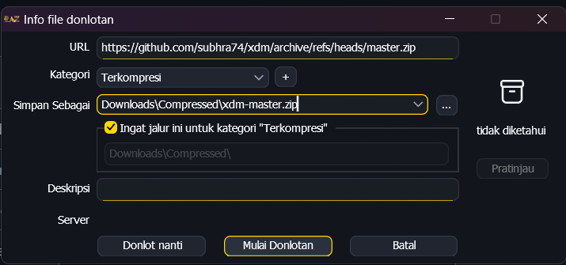<br>
- 🎬 **Video Sniffer & Grabber**: Tombol melayang "Unduh video" dengan logo resmi RAZ otomatis muncul di pojok video streaming (YouTube, TikTok, Vimeo, dll) lengkap dengan deteksi resolusi cepat hingga 4K dan opsi ekstrak audio MP3/M4A:
  <br>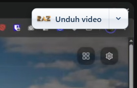<br>
- 🧲 **Dukungan BitTorrent & Magnet Link**: Gak perlu buka software torrent terpisah. Klik magnet link, pilih file yang mau diambil, dan biarkan RAZ DM ngurus sisanya.
- 📦 **Ekstraksi Arsip Otomatis**: File `.zip`, `.rar`, atau `.7z` yang selesai terdonlot bisa langsung diekstrak otomatis ke folder tujuan.
- 🚀 **Integrasi Akun Debrid**: Dukungan langsung buat akun Real-Debrid, AllDebrid, dan Premiumize buat ngebut donlot link premium file-hoster.
- ⏰ **Penjadwal Donlotan Malam**: Antre donlotan lo dan set waktu jalan otomatis saat jam malam biar gak ganggu kuota harian, lengkap dengan fitur auto-shutdown saat selesai:
  <br>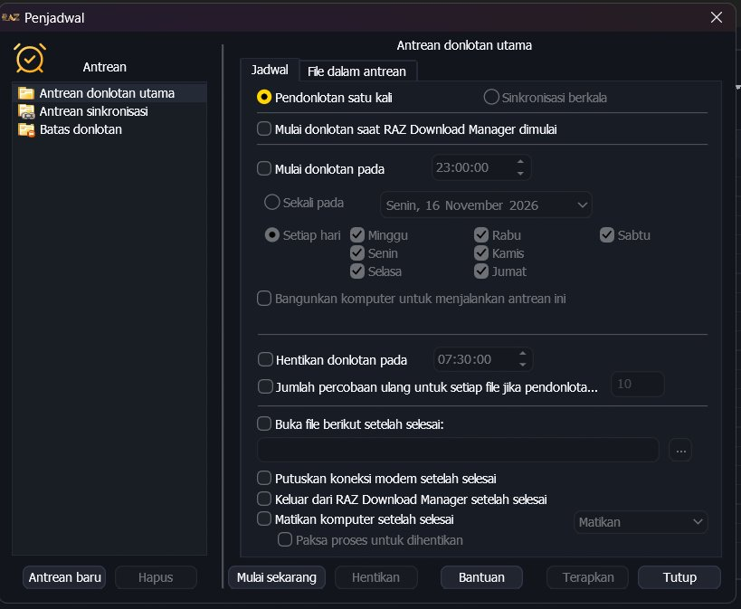<br>
- 🛡️ **Koneksi VPN Khusus**: Batasi aktivitas ngedonlot hanya lewat interface VPN tertentu dengan fitur kill-switch pengaman.
- 🤖 **Support AI Agent (MCP Server)**: Dilengkapi native Model Context Protocol server. AI favorit lo (seperti Claude, Cursor, atau VS Code) bisa ngecek, nambahin, jeda, atau ngatur antrean donlotan lo via percakapan.
- 🎨 **Tampilan Obsidian Dark Mode Presisi**: Tampilan dark obsidian elegan khas RAZ Creative Studio dengan sidepanel kategori yang ringkas dan bebas lag.

---

## 📸 Tangkapan Layar & Antarmuka (Preview)

Berikut tampilan antarmuka resmi RAZ Download Manager v1.0.0 dengan sentuhan tema obsidian elegan khas RAZ Creative Studio:

| 🖥️ Layar Utama (Mode Gelap) | ☀️ Layar Utama (Mode Terang) |
| :---: | :---: |
|  | 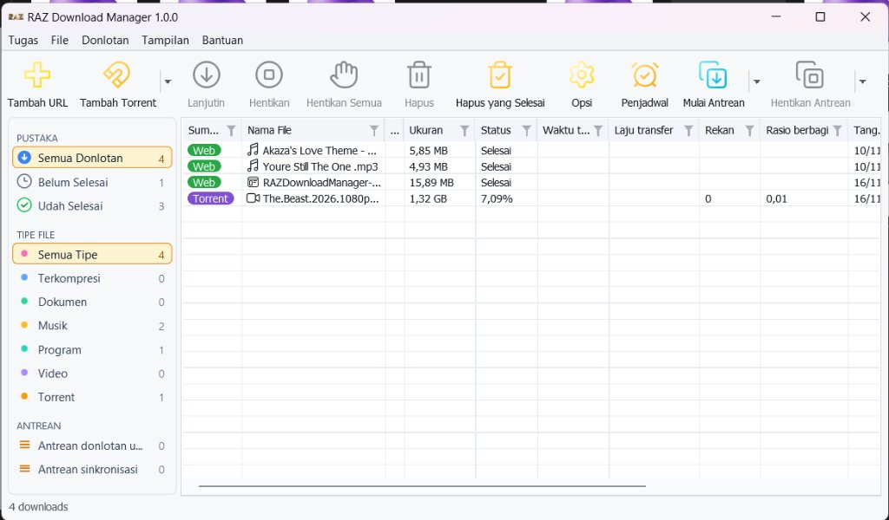 |
| *Tema Obsidian Black, toolbar emas, dan sidepanel rapi* | *Tema Light Windows dengan kontras presisi tinggi & teks tajam* |

| 🧩 Konfirmasi Tangkapan Browser (Mode Gelap) | 🧩 Konfirmasi Tangkapan Browser (Mode Terang) |
| :---: | :---: |
|  | 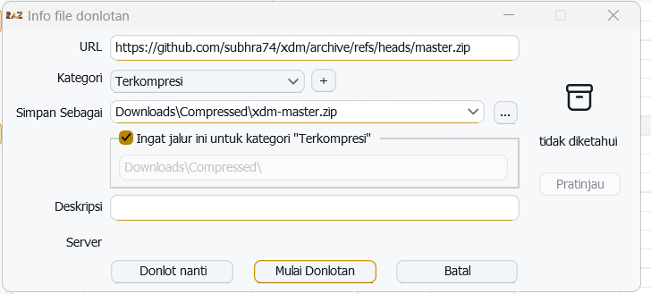 |
| *Deteksi otomatis URL, kategorisasi file, dan folder tujuan (Dark)* | *Dukungan penuh tema terang Windows dengan tombol amber (Light)* |

| 🧲 Tambah Torrent (Mode Gelap) | 🧲 Tambah Torrent (Mode Terang) |
| :---: | :---: |
| 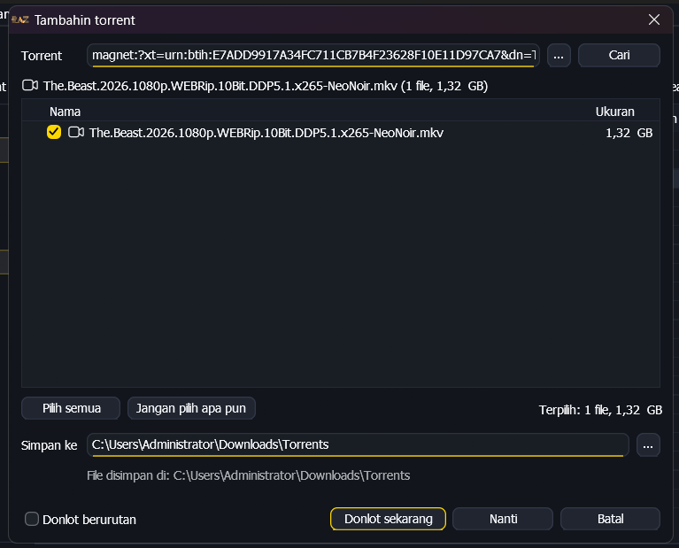 | 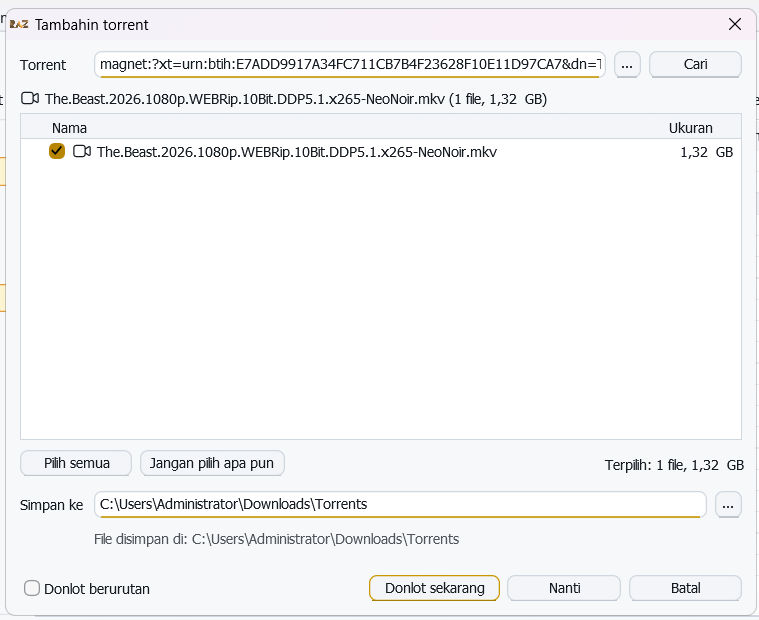 |
| *Deteksi otomatis magnet link & pemilihan file selektif (Dark)* | *Dukungan penuh tema terang Windows dengan tombol amber (Light)* |

| 🔄 Proses Donlot Torrent (Mode Gelap) | 🔄 Proses Donlot Torrent (Mode Terang) |
| :---: | :---: |
| 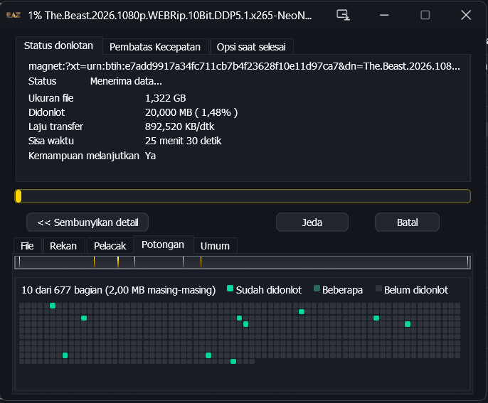 | 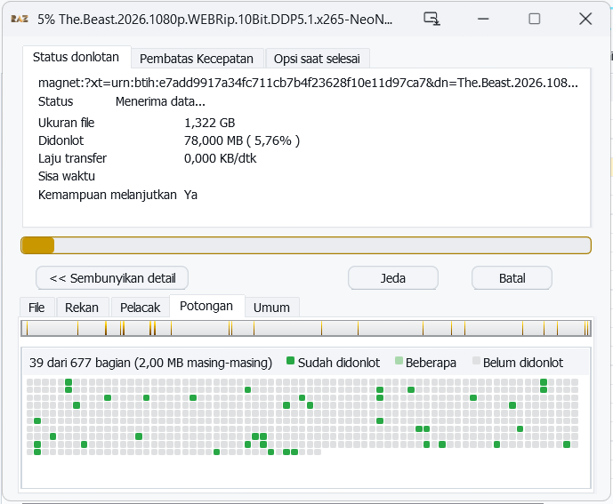 |
| *Visualisasi blok potongan file (pieces) real-time & laju transfer (Dark)* | *Visualisasi potongan torrent tema terang dengan kontras tajam (Light)* |

| ⚡ Proses & Segmen Donlot (Mode Gelap) | ⚡ Proses & Segmen Donlot (Mode Terang) |
| :---: | :---: |
| 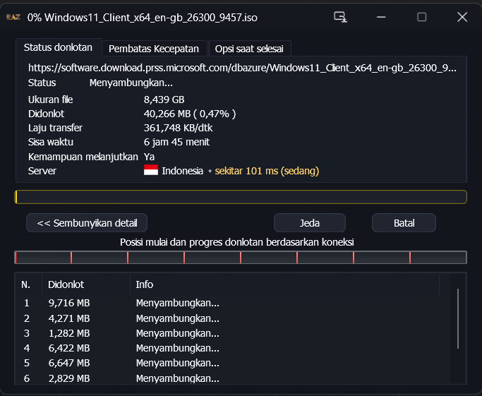 | 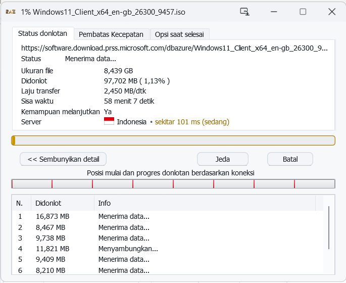 |
| *Pemantauan segmen koneksi multi-thread live, bendera server, dan kecepatan (Dark)* | *Visualisasi segmen koneksi tema terang Windows dengan kontras tajam (Light)* |

| ⚙️ Konfigurasi (Mode Gelap) | ⚙️ Konfigurasi (Mode Terang) |
| :---: | :---: |
| 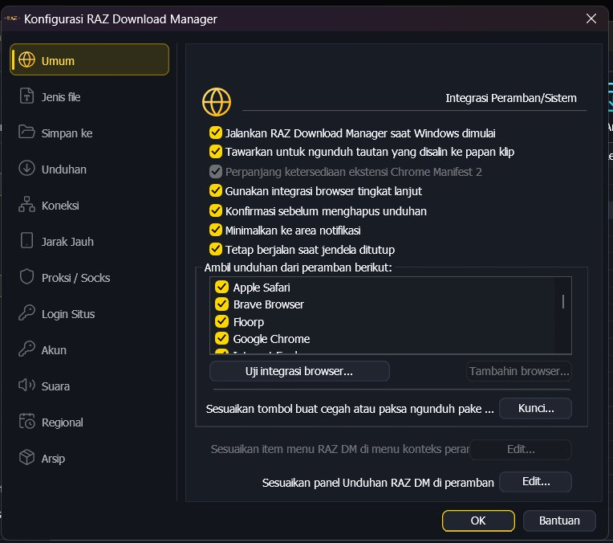 | 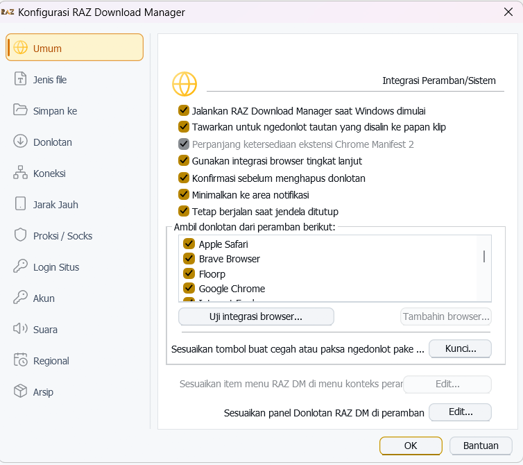 |
| *Pengaturan integrasi peramban, koneksi, dan proksi (Dark)* | *Pengaturan tema terang dengan navigasi tab amber presisi (Light)* |

| ⏰ Penjadwal Donlotan (Mode Gelap) | ⏰ Penjadwal Donlotan (Mode Terang) |
| :---: | :---: |
|  | 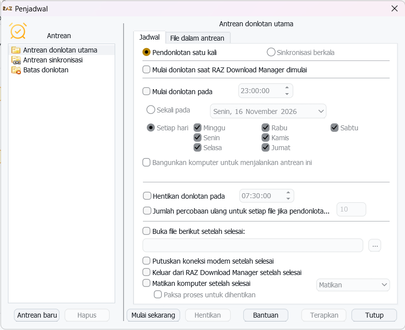 |
| *Otomasi donlotan malam hari, penjadwalan antrean, dan auto-shutdown (Dark)* | *Dukungan penuh tema terang Windows dengan tombol aksi amber presisi (Light)* |

| 🌐 Pilihan Bahasa (Mode Gelap) | 🌐 Pilihan Bahasa (Mode Terang) |
| :---: | :---: |
| 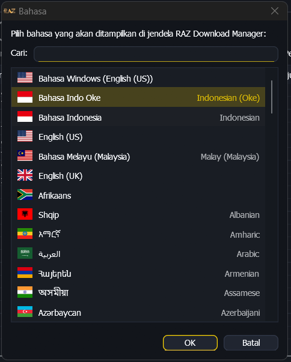 | 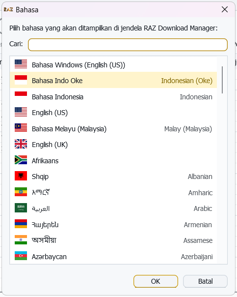 |
| *Dukungan 86+ bahasa dunia dengan opsi Bahasa Indo Oke (Obsidian Dark)* | *Dukungan penuh mode terang Windows dengan tombol aksi amber presisi (Light)* |

| 🎬 Donlot Video dari Halaman (Mode Gelap) | 🎬 Donlot Video dari Halaman (Mode Terang) |
| :---: | :---: |
| 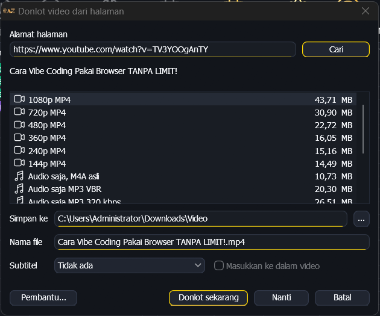 | 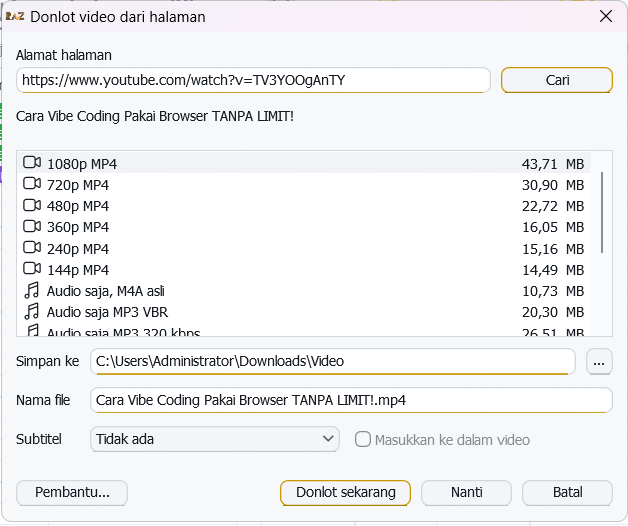 |
| *Deteksi otomatis resolusi video/audio, subtitle, dan konversi format (Dark)* | *Dukungan penuh mode terang Windows dengan tombol amber presisi (Light)* |

| ✅ Dialog Donlotan Selesai (Mode Gelap) | ✅ Dialog Donlotan Selesai (Mode Terang) |
| :---: | :---: |
| 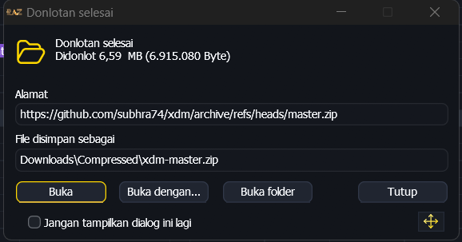 | 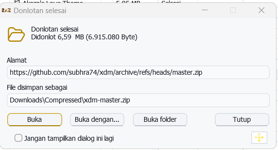 |
| *Aksi cepat buka file, buka folder, dan setel aplikasi pilihan (Dark)* | *Dukungan penuh tema terang Windows dengan tombol aksi amber presisi (Light)* |

| ℹ️ Tentang RAZ DM (Mode Gelap) | ℹ️ Tentang RAZ DM (Mode Terang) |
| :---: | :---: |
| 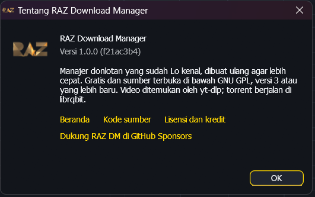 | 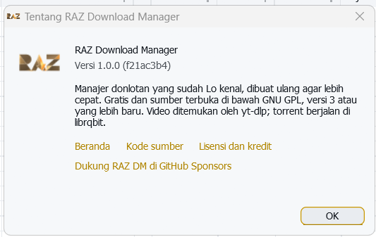 |
| *Informasi lisensi GPL-3, versi biner, dan tautan repositori (Dark)* | *Dukungan penuh tema terang Windows dengan tombol aksi amber presisi (Light)* |

| 🎬 Tombol Unduh Video di Browser (Video Sniffer) |
| :---: |
|  |
| *Tombol melayang otomatis di atas pemutar video browser (YouTube, TikTok, dll) dengan logo resmi RAZ* |

---

## 📥 Pilihan Donlot & Instalasi

Kunjungi halaman [Donlot Resmi](https://dm.it-raz.com/download.html) atau ambil langsung di [GitHub Releases](https://github.com/razcreativestudio/razdownloadmanager/releases/latest):

| Paket Berkas | Keterangan & Rekomendasi |
| :--- | :--- |
| **`RAZDownloadManager-...-setup.exe`** | **Paling Direkomendasikan!** Sekali klik buat instal RAZ DM di Windows, langsung daftarin ekstensi browser, dan setel bahasa. |
| **`RAZDownloadManager-...-portable.zip`** | Versi tanpa instalasi. Cocok ditaruh di flashdisk USB, ekstrak dan langsung jalan. Data kesimpan rapi di foldernya. |
| **`RAZDownloadManager-...-x64.zip`** | Berkas biner mandiri buat yang mau integrasi manual tanpa installer. |
| **`razdm-extension-chrome.crx`** | Berkas biner ekstensi `.crx` resmi buat browser Chromium (drag-and-drop di developer mode). |
| **`razdm-extension-chrome.zip`** | Berkas ekstensi source `.zip` buat browser Chromium (metode *Load unpacked* resmi). |
| **`razdm-extension-firefox.xpi`** | Berkas ekstensi resmi langsung buat browser Firefox dan turunannya. |

> [!NOTE]
> Kalau Windows Defender memunculkan peringatan *"Windows protected your PC"* saat pertama kali pasang, itu karena berkas rilis awal ini belum pake sertifikat berbayar code-signing. Cukup klik **More info** lalu pilih **Run anyway**.

### 🐧 Buat Pengguna Linux

RAZ Download Manager udah dites berjalan mulus di Ubuntu 24.04, Debian 12, Fedora, openSUSE, dan Arch Linux (baik sesi X11 maupun Wayland):

| Paket Berkas | Format & Cara Pasang |
| :--- | :--- |
| **`.deb`** | Ubuntu, Linux Mint, Debian, Pop!_OS: `sudo apt install ./RAZDownloadManager-*.deb` |
| **`.rpm`** | Fedora, openSUSE, RHEL: `sudo dnf install ./RAZDownloadManager-*.rpm` |
| **`.AppImage`** | Jalan di semua distro Linux. Cukup kasih izin eksekusi (`chmod +x`) lalu jalankan. |
| **`.tar.gz`** | Berkas biner mentah portabel buat distro Linux apa pun. |

### 🍏 Pengguna macOS

Paket rilis eksperimental buat **macOS** (arsitektur Apple Silicon M-Series dan prosesor Intel x86_64) tersedia di halaman donlotan.
Buka berkas `.dmg` dan seret RAZ DM ke folder Applications. Saat pertama kali buka, klik kanan aplikasi dan pilih **Open**.

---

## 🌐 Pilihan Bahasa Lengkap (Termasuk Bahasa Indo Oke)

RAZ DM mendukung lebih dari **86 bahasa dunia**. Lo bisa ganti kapan aja lewat menu **Lihat → Bahasa**.

| 🌐 Pilihan Bahasa (Mode Gelap) | 🌐 Pilihan Bahasa (Mode Terang) |
| :---: | :---: |
|  |  |
| *Tampilan dialog pilihan bahasa bertema Obsidian Gelap* | *Tampilan dialog pilihan bahasa bertema Windows Terang* |

> [!TIP]
> Pilih **Bahasa Indo Oke** buat ngerasain sensasi interaksi santai dan luwes khas developer masa kini—tanpa gaya kaku birokratis!

---

## 🛠️ Panduan Build dari Source Code (Buat Developer)

Kalau lo mau ngoprek atau nge-build sendiri langsung dari kode sumber:

### Syarat Perangkat Lunak
- **Rust stable 1.95** atau versi yang lebih baru (MSVC toolchain untuk Windows).
- **Cargo** (bawaan dari instalasi Rust).
- (Opsional) Inno Setup 6 jika ingin membuat paket `.exe` installer.

### Langkah Kompilasi

```powershell
# Clone repositori
git clone https://github.com/razcreativestudio/razdownloadmanager.git
cd razdownloadmanager

# Kompilasi seluruh biner release
cargo build --release

# Jalankan pengujian unit test
cargo test
```

Hasil kompilasi bakal berada di direktori `target\release\`:
- `RAZDownloadManager.exe`: Aplikasi desktop utama (GUI berbasis `egui`).
- `RAZDownloadManager-cli.exe`: CLI headless untuk kebutuhan otomasi terminal atau server.
- `RAZDownloadManager-mcp.exe`: Server MCP untuk integrasi ke AI Assistant.
- `RAZDownloadManager-nmhost.exe`: Host penghubung ekstensi browser.

Buat ngebangun paket installer `.exe` dan arsip `.zip`:
```powershell
powershell -ExecutionPolicy Bypass -File tools\installer\build.ps1
```

---

## 🏛️ Arsitektur Proyek

Struktur modular Cargo workspace (Rust 2024 edition):

| Modul / Crate | Fungsi & Tanggung Jawab |
| :--- | :--- |
| [`crates/engine`](crates/engine) | Jantung download engine: segmentasi berkas, koneksi multi-socket, limit kecepatan, resume |
| [`crates/app`](crates/app) | Antarmuka pengguna desktop utama (egui), tema obsidian, kontrol UI |
| [`crates/cli`](crates/cli) | Utilitas command-line headless buat ngedonlot lewat terminal |
| [`crates/mcp`](crates/mcp) | Server antarmuka Model Context Protocol (MCP) buat asisten AI |
| [`crates/nmhost`](crates/nmhost) | Native messaging host buat komunikasi dua arah sama ekstensi browser |
| [`crates/ipc`](crates/ipc) | Protokol IPC antar-proses dan sinkronisasi status aplikasi |
| [`crates/remote`](crates/remote) | Server web HTTPS lokal buat remote control donlotan lewat HP |
| [`crates/crash`](crates/crash) | Monitor penanganan crash, stack trace, dan freeze detection |
| [`crates/debrid`](crates/debrid) | Integrasi API resmi akun Debrid (Real-Debrid, AllDebrid, Premiumize) |
| [`crates/extract`](crates/extract) | Otomasi uncompress arsip (zip, tar, gz, xz, 7z, rar) |
| [`crates/tools`](crates/tools) | Wrapper bawaan yt-dlp, ffmpeg, dan gallery-dl buat sniffer video dan galeri |
| [`crates/torrent`](crates/torrent) | Engine BitTorrent native berbasis pustaka `librqbit` |

---

## 🤝 Penghormatan & Terima Kasih Kepada Para Kontributor Mister Download Manager

Terwujudnya **RAZ Download Manager** hari ini berdiri tegak di atas dedikasi, waktu, dan kerja keras luar biasa dari para kreator, pengembang, dan kontributor awal proyek **Mister Download Manager (MDM)**.

Fondasi engine multi-thread yang tangguh, arsitektur *clean-room* yang cerdas, sistem penangkap tautan peramban, serta puluhan lokalisasi bahasa dunia adalah karya berharga yang dibangun bersama oleh komunitas sumber terbuka. Kami di **RAZ Creative Studio** menyampaikan rasa hormat dan terima kasih tak terhingga kepada:

- **Ahmed Nefzaoui** ([@anefzaoui](https://github.com/anefzaoui)) — Arsitek dan pencetus awal proyek Mister Download Manager.
- Segenap kontributor komunitas yang telah mendedikasikan pull request, pengujian fitur, laporan bug, dan penerjemahan:

<p>
  <a href="https://github.com/AzureKnigh7" title="AzureKnigh7"></a>
  <a href="https://github.com/specailm5" title="specailm5"></a>
  <a href="https://github.com/osunday" title="osunday"></a>
  <a href="https://github.com/SwiftyPop" title="SwiftyPop"></a>
  <a href="https://github.com/mfat" title="mfat"></a>
  <a href="https://github.com/praveenkumar2K06" title="praveenkumar2K06"></a>
  <a href="https://github.com/shreeramncity" title="shreeramncity"></a>
  <a href="https://github.com/AwesomeIronman" title="AwesomeIronman"></a>
  <a href="https://github.com/Maldo-0750" title="Maldo-0750"></a>
  <a href="https://github.com/Twig6943" title="Twig6943"></a>
  <a href="https://github.com/ADIxxDEV" title="ADIxxDEV"></a>
  <a href="https://github.com/crse" title="crse"></a>
  <a href="https://github.com/dhrubo11" title="dhrubo11"></a>
  <a href="https://github.com/Drigva" title="Drigva"></a>
  <a href="https://github.com/EnderDobra" title="EnderDobra"></a>
  <a href="https://github.com/farjanatech" title="farjanatech"></a>
  <a href="https://github.com/gowzee" title="gowzee"></a>
  <a href="https://github.com/husnainahmedrana" title="husnainahmedrana"></a>
  <a href="https://github.com/justnxhom" title="justnxhom"></a>
  <a href="https://github.com/mayankmohan1992" title="mayankmohan1992"></a>
  <a href="https://github.com/Mpsp4321" title="Mpsp4321"></a>
  <a href="https://github.com/sadatdaniel" title="sadatdaniel"></a>
  <a href="https://github.com/SHURmanizer" title="SHURmanizer"></a>
  <a href="https://github.com/Uyaii" title="Uyaii"></a>
  <a href="https://github.com/Volcanify" title="Volcanify"></a>
  <a href="https://github.com/Zekidt" title="Zekidt"></a>
  <a href="https://github.com/Stark-0505" title="Stark-0505"></a>
  <a href="https://github.com/dr-strange15" title="dr-strange15"></a>
</p>

---

## 📜 Lisensi, Hak Cipta & Ketentuan Hukum

Perangkat lunak ini adalah perangkat lunak bebas (*Free & Open Source Software*) yang didistribusikan di bawah ketentuan lisensi **[GNU General Public License v3.0 (GPL-3.0)](LICENSE)** atau versi yang lebih baru atas pilihan pengguna.

### Pemberitahuan Hak Cipta (Copyright Notice):
- **Basis Kode Asli (Original Codebase & Initial Architecture):**  
  Copyright © 2026 Ahmed Nefzaoui dan para kontributor Mister Download Manager.
- **Pengembangan Lanjutan, Modernisasi Desain & Pemeliharaan:**  
  Copyright © 2026 RAZ Creative Studio ([https://it-raz.com](https://it-raz.com)).

### Hak dan Ketentuan di Bawah GPL-3.0:
1. **Kebebasan Penuh Pengguna**: Pengguna berhak menjalankan perangkat lunak ini untuk tujuan apa pun, mempelajari cara kerjanya, serta memodifikasi kode sumber sesuai kebutuhan.
2. **Kewajiban Berbagi Serupa (Copyleft)**: Segala bentuk distribusi ulang baik dalam bentuk biner maupun kode sumber modifikasi wajib tetap menyertakan kode sumber lengkap di bawah lisensi terbuka GNU GPL-3.0 yang sama.
3. **Tanpa Jaminan (Disclaimer of Warranty)**: Perangkat lunak ini didistribusikan dengan harapan dapat bermanfaat bagi masyarakat luas, namun TANPA JAMINAN APA PUN; bahkan tanpa jaminan tersirat atas KELAYAKAN JUAL atau KESESUAIAN UNTUK TUJUAN TERTENTU.

### Pustaka & Komponen Pihak Ketiga:
RAZ Download Manager memanfaatkan pustaka-pustaka terbuka berkualitas:
- Framework UI: [egui](https://github.com/emilk/egui) melalui fork storytold & [storytold/craft-libs](https://github.com/storytold/craft-libs) (MIT / Apache-2.0).
- BitTorrent Core: [librqbit](https://github.com/ikatson/rqbit) (Apache-2.0).
- Penanganan Kompresi: [zip](https://github.com/zip-rs/zip2) (MIT) dan utilitas 7-Zip.
- Video & Galeri Helper: [yt-dlp](https://github.com/yt-dlp/yt-dlp) (Unlicense) dan [gallery-dl](https://github.com/mikf/gallery-dl) (GPL-2.0+).
- Ikon Bendera: [flag-icons](https://github.com/lipis/flag-icons) (MIT).
- Rincian atribusi lisensi lengkap seluruh pustaka dapat dilihat di [ATTRIBUTION.md](ATTRIBUTION.md).
